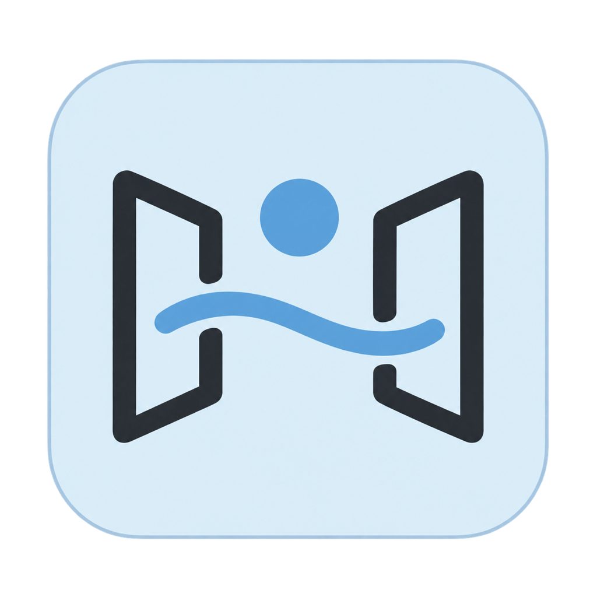

# irudd-scope

A private workspace where coding agents leave things for a human to inspect. An Electron app stores and displays artifacts on macOS and Windows 11 x64. Local publishing works while Scope is open, without a VM. An optional paired hub persists remote CLI publications before delivery and attempts delivery while the desktop is connected. Codex and Claude can publish through the same CLI.

The repository is public. Artifact data and credentials stay private. Remote publishing belongs on a private tailnet. Paired Scope instances can exchange selected tabs over a separate encrypted connection.

SQLite stores artifact contents, metadata, ordinary settings, and workspace preferences. Mac credentials live directly in Keychain. Windows credentials use DPAPI encryption for the current Windows account and are saved encrypted in SQLite. The private discovery file holds the CLI publishing token. The desktop owns delivered artifacts. Direct publishing requires Scope to be running; paired hubs buffer up to 50 pending publications for 48 hours.

## Install on macOS

```sh
curl -fsSL https://raw.githubusercontent.com/alundgren/irudd-scope/main/install.sh | bash
```

The installer keeps its own clone in `~/.local/share/irudd-scope`, installs
Vite+ if needed, and builds Scope locally. It installs a complete `Scope.app`
in `~/Applications` for Finder and Spotlight, then opens it. Re-running the
installer replaces an older managed app symlink automatically. Apple's command
line tools are required. If they are missing, run `xcode-select --install`,
finish that installation, and run the Scope installer again.

To reduce repeated Keychain prompts after updates, see [optional local signing](docs/development.md#optional-local-signing).

## Install on Windows 11 x64

Install Git for Windows, then run this in native PowerShell:

```powershell
irm https://raw.githubusercontent.com/alundgren/irudd-scope/main/install.ps1 | iex
```

The installer keeps its clone and app builds in `%LOCALAPPDATA%\irudd-scope`,
installs the pinned Vite+ if needed, builds Scope locally, and adds a Start Menu
shortcut. It uses Windows PowerShell and the .NET Framework compiler included
with Windows. No administrator access, Developer Mode, Visual Studio, separate
Node installation, or WSL is needed. Windows ARM is not supported.

Scope keeps an independent Windows profile. Closing its last window saves
pending changes and quits; it does not run a background service.

## Updates and agent tools

On startup, Scope checks the latest SHA on `main`. A new commit builds in the
background. Choose **Restart to update** when ready. Failed builds leave the
current app usable. Settings includes update status, build output, Cancel,
and Retry. There are no prebuilt downloads or GitHub release builds.

In **Settings → Agent tools**, install the `irudd-scope` CLI and the Scope
skill globally for Codex and Claude Code. The CLI uses the app's runtime and
updates with it. Both Scope skills install from the app's bundled files and
follow its active build. Open a new terminal after installing the CLI.

See [installation and recovery](docs/development.md#installed-app) for paths,
build requirements, and removal.

## Open another Scope's tabs

In **Settings → Other Scopes**, create a guest invitation and paste it into the
other desktop. Review the named peer and approve sharing on both desktops.
Scope uses the installed Tailscale network and saves the pair in protected storage.

Eligible artifacts, native plans and folders appear as guest tabs. Content stays
with its owner; each desktop keeps its own navigation. Both apps must be running
and awake. Disable sharing or forget a peer in Other Scopes. See
[guest connections](docs/architecture.md#guest-peer-connections) for permissions
and connection requirements.

## Install on a remote

On a Linux remote already connected to your tailnet:

```sh
curl -fsSL https://raw.githubusercontent.com/alundgren/irudd-scope/main/install-cli.sh | bash
```

Open a new login shell and run `irudd-scope setup`. Review the installation
paths and private endpoint, then confirm. Setup installs the hub as a systemd
user service, installs the Scope skill for Codex and Claude Code, and configures
Tailscale Serve on an unused HTTPS port. Existing Serve routes stay intact.

Paste the printed pairing URL into **Scope → Settings → Remotes** on the desktop.
The link expires after ten minutes and can be used once. Scope keeps the
connection credential in its protected store and opens all connections to the remote.
The remote does not need permission to initiate connections to the desktop.

Run `irudd-scope pair` for a fresh link. Each hub pairs with one desktop. A desktop
can connect to several hubs independently. Disconnect and removal are in
Settings; service commands and prerequisites are in
[remote access](docs/development.md#remote-access).

After the installed desktop app updates and restarts, it updates connected remotes
to the same commit. Each remote builds its hub, CLI, and skill together before
restarting the hub. Offline remotes catch up when they reconnect. Settings →
Remotes shows progress and failed updates with Retry. Older installations need
one manual run of the standalone installer and `irudd-scope setup` to enable
this behavior.

## Development

Install the Vite+ version in the [workspace catalog](pnpm-workspace.yaml), then run:

```sh
vp install --frozen-lockfile
vp run ready
```

The project pins Node and pnpm through Vite+. Linux supports development and testing.
macOS and Windows 11 x64 are desktop deployment targets. Native Windows builds
use PowerShell; the remote hub remains a Linux systemd service.

Memory on Windows uses the native irudd-okf executable installed with its
PowerShell installer. Scope keeps automatic upgrades off there. Other native prerequisites include `gh` for PR inboxes and
memory authentication, Git for memory sync, and Python 3 for agent retrospectives.

Scope displays text, Markdown, raster images, interactive HTML, and downloadable
files. Published `.excalidraw` files are downloadable files. The built-in
Sketchpad is a personal Excalidraw canvas opened from search; agents have no
access to it. Built-in plugins run inside a shared tab host with persistent
groups and events limited to each group.
Development launches run from the checkout and do not update themselves.

Pull request inboxes bind to one GitHub repository. Their first successful sync
normalizes a verified alias to its canonical path; later repository path changes
require a new inbox. See the [inbox commands](docs/development.md#github-pull-request-inboxes).

The [Scope CLI skill](.agents/skills/irudd-scope/SKILL.md) guides agents through
publishing artifacts, updating existing IDs, generating narration audio, and handling uncertain results.

See [development and launch commands](docs/development.md),
[architecture and ownership](docs/architecture.md),
[storage and recovery](docs/storage.md), [protocol](packages/protocol/README.md),
[technology](docs/technology.md), and [UI decisions](ux.md).
[Visual design](docs/visual-design.md) describes the desktop's shared tokens
and controls. Contributor instructions start in [AGENTS.md](AGENTS.md).

MIT licensed.

## Memory library

Librarian browses and searches a local irudd-okf bundle and presents one dreaming
decision at a time. Git and remote sync are optional. Select an existing folder
in Memory settings or ask your coding agent to initialize a new local bundle.
Existing older bundles need an explicit migration; Scope never migrates them
when connecting. Weekly dreaming reminders start on and can be disabled.

```sh
irudd-scope librarian guide
irudd-scope librarian read
irudd-scope librarian apply request.json
```

Dreaming starts and finishes through your existing agent conversation. The
agent consolidates, deduplicates, promotes and archives routine memories itself
and asks you about procedure rewrites, applicability changes and removals that
would lose evidence. Scope records exact human decisions and automatic changes,
with before and after text, actor, reason and evidence. Interrupted queues persist and require
an explicit resume. Completed changes remain available for inspection. The
Librarian tab retains old wiki drafts as copyable recovery text.
