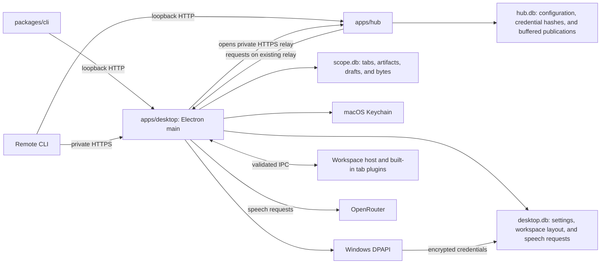
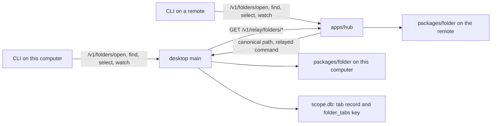

# Architecture

Scope stores artifacts from coding agents and displays them in a macOS or Windows 11 x64 desktop
workspace. The desktop owns the library. Direct publication requires an awake
computer running Scope. Paired hubs temporarily store CLI publications before
attempting delivery while the desktop is connected.



Speech generation lives in `apps/desktop/src/voice/`. Desktop main submits
OpenRouter requests using the shared credential store, persists request receipts
and audio in `desktop.db`, and serves short authenticated submission, status,
cancellation, billing-refresh, and download requests through the library HTTP
server. `packages/protocol/src/voice.ts` owns the public contracts; the CLI owns
explicit audio and receipt exports. The hub forwards the same routes without
provider calls or speech storage. Speech results are independent of tabs.

## Folder tabs

A Folder tab shows an agent's working folder, on this computer or on a paired
remote, as a live tree. Only agent commands open one; Scope has no button,
menu item, or drop target for it. Files stay on the machine that has them.



`packages/folder` owns all file system work for both machines: the canonical
path, per-directory listings, `.gitignore` rules, containment, byte-range reads,
change feeds, and content and file name search. It reserves a typed staged write
function.
Desktop main uses it for local folders; the hub uses it for remote folders.
`packages/protocol/src/folder.ts` defines the routes and wire contracts and
imports no file system code.

A Folder tab's identity is its machine and canonical path. The machine is
`local` or the desktop's remote ID and always comes from the connection that
delivered the command; Scope ignores any machine named in the body. When the
desktop forwards a relayed folder command to its own listener, it adds a
`Scope-Relay-Origin` header with a secret that exists only in that process. The
canonical path comes from `canonicalFolder`, run on the machine that has the
files: desktop main resolves local paths and a hub resolves its own before
relaying. `scope.db` enforces one tab per key in the `folder_tabs` table inside
the same transaction that creates, restores, unhides, or renames the tab.

The Folder plugin is an ordinary tab type: temporary by default, bookmarkable,
and trashable. Opening a folder whose tab is trashed or hidden restores or
unhides that same tab at the end of the strip. Main sends the change to the
renderer as `scope:folder-tab-opened`. The renderer merges the title and folder
into its copy and keeps its own expanded folders and selection. Brand-new tabs
select themselves only when no tab is selected; restored and unhidden tabs
never change selection. A per-tab `revision` in the Folder tab state counts
main-side changes, and `scope.db` ignores renderer saves with an older revision.
Folder tabs are unread through a tab ID set in renderer memory until selected.

`folder find` reports whether a folder's tab is in the strip; a tab in Trashcan
or closed to the drawer is not open. `folder select` checks the file on the
machine that has it, then opens the tab like `folder open` and, in the same
transaction, sets the selected file, adds every folder down to it to the
expanded list, and bumps `revision`. `scope:folder-tab-opened` carries the
selected file so the renderer replaces its selection and expands those folders
while keeping its other expanded folders.

`folder watch` is a long NDJSON response with a heartbeat every 10 seconds.
Desktop main ends it with `closed` at the moment the tab leaves the strip:
trashing and deletion reach the plugin through the lifecycle. Closing a
bookmarked tab to the drawer, and reopening it, are their own lifecycle
operation (`scope:set-tab-hidden`), queued in order with agent commands. It
changes only the stored tab's visibility, so a renderer save that `scope.db`
ignores as older cannot undo the close, and it tells the plugin before the
renderer's request resolves. The watch ends even if the tab is reopened right
after. A hub relays a watch like other
requests but keeps it in its own count of at most 16, apart from the 16
publication slots, and reserves the slot before resolving the path, so
concurrent watches cannot exceed it. If the desktop does not start answering
within 20 seconds, the hub fails the watch and cancels it on the relay. The
desktop's relay keeps its own watch count, so idle watches never block
publishing, and it answers busy instead of dropping the relay. The desktop
uploads the watch response to the hub with `node:http`, because fetch gives up
on a request body that is still streaming after 300 seconds.

The plugin's main handlers read the folder through one source contract. Local
sources call `packages/folder`. Remote sources use `Remotes.request`, a
session-bound streaming request to the hub's file routes with raw bodies, caller
cancellation, a deadline per operation, an idle limit, and cleanup when the
relay session ends. It does not use the 32 MiB publication path. The hub's
change feed writes a heartbeat every 10 seconds, under its 30-second socket
timeout. macOS and Windows watch a folder recursively; Linux watches each
directory that is not ignored and polls every few seconds when it runs out of
watches. `.git` and ignored folders are never watched.

The filter uses a path list that desktop main keeps in memory for each watched
tab. A background walk builds it, locally with `packages/folder` and remotely by
listing directories through the hub, four at a time. Change feed events keep it
current. A created directory is walked, because its files may have no events of
their own, and a changed `.gitignore` or an overflow rebuilds the list. Above
200,000 paths, or when a remote directory has more entries than one listing
returns, the list is dropped and each filter text becomes a `names` search on the
folder's machine; changes then ask an open filter again about once a second. Content search always runs on the folder's machine with
`searchFolder`, one search per tab; a new query or Cancel aborts the previous
one, and the hub stops reading files when its response closes. Search enters a
directory and reads a file only through handles checked to be inside the
folder, never follows a final symlink, and skips FIFOs and other special files
without waiting on them. Neither the path
list nor search results are stored. Previews read byte ranges through the same
source and show them with the published-file viewers in
`renderer/file-views.tsx`, which take bytes, a kind, a media type, and a title.

The desktop advertises folder support with `Scope-Relay-Capabilities: folders`
when it opens the relay. A hub forwards folder commands only to a desktop that
advertised it, because an older desktop drops the whole relay on an unknown
request. Folder commands are never queued. An older hub answers 404 and the CLI
asks for an update on that machine. Only the desktop connection credential can
use the hub's `/v1/relay/folders/` routes; the hub's publishing token cannot.

Reads and listings go through handles checked to be inside the folder. Linux checks
the kernel path of the opened handle. macOS and Windows compare the handle with a
fresh walk from the root, which is a series of checks rather than one atomic one, so
a folder swapped for a link and back between two checks could pass. Change feeds have
their own per-remote budget of 64, separate from the 32 streamed listings, reads, and
writes; desktop main queues listings and reads 8 at a time per machine.

Dropping files on the tree copies them in; it is the only time Scope writes to a
shared folder. The preload turns dropped `File` objects into paths with
`webUtils.getPathForFile` and sends them straight to main, so a page can pass
dropped files but never a path of its choice. Main lists the dropped files and the
files and empty folders inside dropped folders (skipping links, special files, and
`.git`), records each file's device and inode, reads each target folder to find
names that exist, and returns a plan. Each item has its own ID, so two dropped files
with the same name are asked about separately. Nothing is written until the
renderer answers Replace, Keep both, or Cancel for each existing name. Main then
streams one file at a time to the folder source, reading only a file whose path still
leads to the recorded device and inode (edits to that file are copied): locally to `writeFolderFile`, remotely as the raw body of
`PUT /v1/relay/folders/write`, sent with `node:http` because fetch gives up on a
response that waits more than 300 seconds for a long upload.

`writeFolderFile` opens each folder on the way as a child of the one before,
without following links, and creates a missing one only inside an opened folder
that is checked to be inside the root before and after. The bytes go to a staged
`.scope-partial-*` file at the top of the folder (in the destination itself when
that is on another file system). The commit checks that the copy was not
cancelled and that the destination is still inside the root, then renames the
staged file into the opened destination, or without Replace hard-links it, which
fails if the name appeared during the copy; the renderer then asks again. A file
system without hard links fails clearly instead of checking and renaming. After the
commit the destination is checked again, and a file committed into a folder that
moved out meanwhile is removed. Every step names the opened folder itself rather
than its path. On Linux the calling process does this through `/proc/self/fd/N`.
Node has no directory-relative calls on macOS and Windows, and a process's working
directory is shared by all its threads, including file work other code already
queued, so Electron main and the hub never change theirs. There writes run in the
folder writer process (`folder-writer.mjs` beside each app's bundle, started with
`fork` on first use, idle-unreferenced, restarted after an exit). The app streams
the bytes to it over IPC, at most 16 chunks ahead; it runs each step synchronously
with its own working directory set to the folder and checked to be the opened one,
and uses only absolute paths and descriptors otherwise. Cancelling, or the app
disconnecting, aborts its writes and removes what they staged. "Inside the root"
means that each parent reached through `..` is the folder opened on the way down.
Windows resolves relative names from the directory's path, so there only those
checks keep writes inside. A cancelled,
failed, or disconnected copy, including a hub request that closes after its body
arrived, removes the staged file and commits nothing. Listings, walks, search, and
change feeds hide staged names and `.git` in any letter case. When a drop finishes,
main sends one `dropped` line listing the written paths to every `folder watch` on
the tab.

Save to computer opens the native save dialog in Downloads, streams the file from
the folder source into a `.scope-partial-*` file beside the chosen name, and
renames it only when every byte arrived. Remote saves read
`GET /v1/relay/folders/read` without an end. Saves and drops report progress to
the tab, can be cancelled, and stop when the tab closes.

## Tab transfer

`apps/desktop/src/transfer/` owns desktop pairing, temporary invitations,
authentication, and transport cleanup. `packages/protocol/src/transfer.ts`
defines the versioned invitation and portable artifact manifest. Desktop main
exposes named IPC for Settings, Send, and Import. The renderer receives metadata
and status, never saved pairing keys. Copying a generated secret uses a named
main-process clipboard operation.

Each pair has an independently generated random secret in the credential store
and peer identity and name in `desktop.db`. Signed invitations bind the source,
connection address, and fifteen-minute lifetime. Receivers verify signatures
before connecting. AES-256-GCM messages use HKDF-derived directional keys,
fresh nonces, and invitation-bound authenticated data. Responses identify the
source and originating request. Repeated requests do not repeat mutations;
live invitations bound accepted request counts.

Tab transfer requires a user-installed Tailcat CLI on each desktop. Scope searches
PATH, including native executables on Windows, and the standard Mac Homebrew locations, and reports a missing CLI when a
transfer starts. Scope does not install, download, or bundle Tailcat.

Desktop main runs a TypeScript transport supervisor using its existing runtime.
The supervisor owns one loopback HTTP listener and a Tailcat process serving
only that listener's port, with ephemeral keys. Version 2 invitations sign the
port alongside the address and lifetime. Version 1 transfer links are rejected;
both desktops must use version 2 links. Existing saved pairings remain valid.

The supervisor stops Tailcat before releasing its HTTP port on cancellation,
expiry, main-process disconnect, or CLI failure. Requests and responses have
size limits, deadlines, and bounded concurrency. The target uses the CLI's
loopback port forwarding and sends encrypted messages over HTTP. Pairing secrets
and payloads never enter CLI arguments; the invitation's connection address does.
Tailcat is experimental; its hosted relays can observe connection metadata and
provide rate-limited service without uptime guarantees.

Send freezes an ordinary artifact, including an Excalidraw file, as published.
Sharing links and Scope-to-Scope pairings are created only in the desktop app.
The receiver can give an agent a tab sharing link and authorize
`irudd-scope import-link LINK`. The authenticated publication API exposes only
`POST /v1/transfers/import` for this operation. Desktop main performs Inspect
then Import without a renderer confirmation; pairing keys stay in the desktop credential store.
The CLI uses normal receiver discovery or a connected paired hub. Imports are
never queued, and the import request has a bounded five-minute deadline.
Conversations, proposals, credentials, and agent sessions remain local. Inspect
authenticates and retains the approved manifest in main. Import validates the
download against that manifest and requests final source authorization.
Authorization is serialized against Cancel and Forget. Cancel stops imports
not yet authorized; closing or forgetting the source cannot retract previously
authorized bytes.

`library/transfer-import.ts` commits the new tab, artifact, bytes, and retry
receipt together in `scope.db`. New local identities and omission of the
original unique name prevent overwrites. Repeated imports return the existing
copy. Removing that copy retains its receipt until expiry and prevents
recreation. Explicit desktop Import or an authorized agent command precedes HTML execution under the existing trusted
content behavior. Both apps must be online and awake. Invitations and snapshots
exist only in memory, with no offline queue or continuing synchronization.
Only ordinary file tabs transfer. Plans, PR inboxes, and retros are excluded;
PR inboxes and retros keep additional records that are not in the portable
manifest.

## Structured plans

A named `plan` artifact stores one versioned JSON document in existing SQLite
artifact bytes. The document contains authored overview HTML, goals, visuals,
checks, work items, exact retained proposal bases, agreement and evidence.
`packages/protocol/src/plan.ts` owns schemas, reference and dependency validation,
update preservation rules and the pure selected-item projection. The library
validates uploaded bytes and revision/basis rules inside the publication transaction.

`plugins/plan` renders Overview and Work items. Overview receives validated proposal
data before authored scripts run. Inspecting a retained basis uses its original
HTML and records. Reading state persists with the workspace in SQLite. Native
controls use Scope tokens; authored content keeps its presentation.

The CLI assembles JSON and HTML and uses ordinary artifact reads and revision-checked
publication. The paired hub transports the same bytes and queues writes without
new routes or a plan service. Reads and basis capture need the desktop online.
Scope neither orchestrates agents nor infers agreement or verification.

Legacy HTML plans convert to ordinary HTML artifacts and file tabs, preserving
bytes and lifecycle state. Late legacy publication follows the same conversion;
HTML cannot replace an existing structured plan.

## Pull request inboxes

A pull request inbox is a named `pull-requests` HTML artifact bound to one
GitHub repository. Its tab is built-in, so it is always permanent and cannot
move to Trashcan. Deleting the artifact removes the inbox. `packages/protocol/src/pull-requests.ts` owns its
validated commands and snapshots. `library/pull-request-store.ts` owns the
repository binding, current open PR facts, local notes and snoozes, review
baselines, current agent assessments, and inbox-owned JSON app state in `scope.db`. These records belong
to the tab UUID. Publishing another HTML revision preserves them.

`plugins/pull-requests/gh-process.ts` runs the installed `gh` executable without
a shell, using the desktop user's existing login. `gh.ts` reads GitHub facts
and on-demand details. `sync.ts` owns one adaptive polling scheduler and shares
repository reads across inboxes using the same desktop account. It cancels work
on suspension, tab removal, and shutdown. A complete inventory commits
in one transaction and removes PRs no longer open. Failed or incomplete reads
preserve the previous inventory. Local and agent records have separate version
checks and do not get replaced by GitHub facts.

First load commits a complete lightweight inventory before enriching checks,
mergeability, and conversations in bounded batches. Checks, mergeability, and conversations are Unknown and sync remains
in progress until enrichment finishes. An enrichment failure retains that valid
base list. Once a base inventory has been committed, retries and later refreshes
read and commit enriched facts together, preserving cached facts on failure.
This remains true after restart; an incomplete membership read never replaces the list.

`plugins/pull-requests/view.tsx` hosts trusted authored HTML and injects
`window.scope.pullRequests` before its scripts run. The HTML receives immutable
arrays and issues validated operations through the host, rather than accessing
SQLite or credentials. The host subscribes before its first snapshot read and
reloads durable state after invalidation or reconnect. Refreshing PR state
preserves the iframe; publishing a new HTML revision replaces it after pending
local edits finish saving. Transient notices carry no replay history.

`plugins/pull-requests/frame-host.ts` owns the inbox's authored frames and
floating content windows. `scope.windows.open` accepts HTML and JSON context;
the host injects the same Scope SDK into each window before its scripts run.
The host broadcasts current snapshots and matching detail refreshes to all
subscribed frames. A tab-scoped transient message channel lets project HTML
coordinate its own interactions. Window content, layout, and selection belong
to the project. Scope renders window controls and validates operations.
Frames have separate identities and link registrations. Closing releases their
read requests and subscriptions, and returns focus to a surviving opener.
`scope.pullRequests.state` reads and writes one versioned JSON object owned by
the inbox. Validated set, patch, and delete commands commit through the existing
store transaction and emit committed state on the inbox event stream. The host
delivers these events only to that inbox's HTML frames; desktop controls do not
interpret the state. State versions are independent of PR and HTML versions.
All affected frames flush local edits before an HTML replacement or quit.
Workspace flush callbacks receive a save or close purpose. Retention checks and
Send flush edits while allowing authored windows to open; quit, tab removal,
and HTML replacement prevent new windows in the affected inbox until saving finishes.

Explicit `details` commands load bounded batches of PR IDs into the same
temporary main-process detail cache used by individual reads. Each result
identifies its captured head and base commits or reports its own failure.
The batch has a time and reply-byte budget; successful results survive a
partial failure. Request ownership is separate from live detail subscriptions,
so changing a watched PR does not cancel selected preloads. Cache retention is
bounded; account changes and lifecycle cancellation release pending work.
No detail bytes or floating-window state are persisted.

Configured inboxes refresh automatically while Scope is running and awake.
Selection, wake, and reconnect request coalesced fresh reads; Sync remains a
fallback. Foreground, background, and inspected-PR reads use different target
intervals, lengthened to fit observed GitHub cost and remaining quota. The
500-point hourly account target controls admission of new automatic jobs;
admitted jobs finish. Manual Sync and detail reads bypass that routine wait,
while every request respects actual quota reserve and throttling. Main owns
the timers; renderer interests identify the visible inbox and every subscribed PR.
An inspected PR's reviews refresh without downloading its captured diff again.
Agents publish inbox HTML with named JavaScript views. GitHub access is
read-only. Review submission and merges remain on GitHub. Authenticated HTTP
commands work without the tab being mounted. Paired hubs forward them and keep
no PR state.

## Agent retrospectives

A retro is a permanent named `retro` HTML artifact. The operator starts an
ordinary coding session and asks its agent to review earlier sessions. Scope
never launches that agent. The agent discovers native Claude and Codex history
locally or with its existing SSH access, using the public `irudd-scope-retro`
skill and native collection helper maintained in this repository. The desktop
accepts normalized inventories and findings; it does not parse or archive
native transcripts.

`packages/protocol/src/retro.ts` owns public configuration, report, command,
tracking, history and event contracts. `library/retro-store.ts` owns review
records and bounded authored state in `scope.db`. The desktop derives
retrospective sources from its own machine and paired remotes. Machine identities and connection endpoints are included in the public
configuration so an agent running elsewhere can identify the intended hosts.
Per-machine, repository and optional memory preferences are in `desktop.db`.
Hubs forward live retro commands and retain no retro tracking or native history.

`plugins/retro` injects `window.scope.retros` before authored scripts. The HTML
can record decisions, comments and investigation requests, update its own JSON
state, and open completed reports. It has no finish, file, SSH, Git or model
execution method. Accepting a proposal records a decision; the existing agent
applies approved corrections through its normal tools and records the outcome.
The CLI listener sends requests to that existing coding session. Copy agent
request supports manual delivery.

Finish is an agent command following the operator's conversational instruction.
It freezes the report and commits source/runtime initialization and successfully
reviewed native session IDs in one `scope.db` transaction. Initialization is
explicit even when discovery found no eligible sessions. Start now uses the
saved discovery cutoff. From date uses the agreed historical initialization
cutoff while preserving the actual discovery timestamp as the evidence bound.
Both cutoffs remain fixed and select whole sessions by their native start time.
Interrupted retros and unavailable sources leave
reviewed-session markers and initialization unchanged. Publishing a report
records its retro-agent exclusion immediately, so even interrupted retro
conversations stay excluded from later discovery. A resumed audited session stays skipped; explicit manual
review remains possible.

Completed history points to the retained tab's final report. Normal closing
keeps permanent reports. Explicit deletion removes the report and history
entry, while independent audit and initialization records remain. Finished
reports reject later domain, authored-state and ordinary HTML publication
writes. The workflow has no session monitoring service or resumable job state.

## Personal memory

Librarian is the desktop view of a local irudd-okf bundle. The file engine owns
bundle formats, immutable revisions, accepted recall, eligibility, classification,
source checks, deletion and restoration. Scope calls the installed CLI with
structured JSON. It never starts an OKF browser server.

`packages/protocol/src/librarian.ts` defines agent commands and the shared
presentation. `apps/desktop/src/librarian.ts` owns dreaming runs, session
capabilities, queues, human decision recording and selection.
`apps/desktop/src/librarian-reads.ts` builds the read-only Browse, Connections,
Stages and Activity projections from irudd-okf reads. `desktop.db` stores
the run document and idempotency receipts. The renderer's named IPC is the only
Scope path for human acceptance or rejection. The authenticated agent endpoint
can present, propose and select with an active run capability. Runs allow a
fixed list of routine categories unless the agent passes the person's narrower
list. irudd-okf's human-required flag still decides which changes reach the
person. Its read returns
the same projected page and selected raw content that the UI displays.
Capabilities remain in process memory and expire on restart. Resume requires an
explicit user request and a fresh session attachment. Scope never calls a model,
launches an agent, or finishes a run on a schedule.

The memory plugin keeps browsing and reading, connections, stages, recorded
activity, machine status, one human decision, and completed-change inspection
in separate views. Full queues stay in SQLite; projected responses include only
the selected full proposal or recorded change, at most ten completed summaries,
and bounded pages of summaries. History scans read at most the 1000 newest
recorded changes. Machine status comes from the memory service, not irudd-okf. Old tab states migrate with their original document and
read-only draft retained. Reminder due and dismissal dates share the persistent
Librarian document. Renderer checks announce a due reminder while the app is
running and never invoke the file engine or an agent.

`apps/desktop/src/memory.ts` resolves the selected local folder or optional
synced clone. `packages/memory-sync` serializes CLI file operations with any
configured Git sync. Local folders require neither Git nor a remote. Only
repository sync configuration goes to paired hubs; desktop-local paths do not.
Repository sync and daily upgrades retain their own opt-in timers. There is no
periodic installation or curation check for a local library.

Opted-in sync commits changed Markdown and portable OKF manifests and review
history, fetches, rebases and pushes only when the clone is ahead. Runtime locks
and journals remain local. Git authenticates with the machine's own gh login.
Conflicts become pull requests on `memory-conflict/HOST-TIME`; Scope never merges
them. Git changes and CLI operations share a queue and the OKF writer lock.
Turning Git sync off preserves local reading and the existing bundle.

CLI request files are private temporary files removed after each operation.
Scope verifies bundle identity and format before mutations; version mismatch
reports migration instructions without changing an existing bundle.

## Names and ownership

Use the same names in code, documentation, diagrams, issues, and reviews.
Folders name the work they own. Names in saved records, commands, and wire
formats are compatibility contracts.

| Name             | Meaning                                                                                          | Owner                                                                                                     |
| ---------------- | ------------------------------------------------------------------------------------------------ | --------------------------------------------------------------------------------------------------------- |
| Artifact         | Latest published metadata and content for one stable ID.                                         | `packages/protocol/src/index.ts` defines the contract; `apps/desktop/src/library/` stores and serves it.  |
| Revision         | Increasing integer for an artifact; writers supply the revision they read.                       | Artifact protocol and desktop artifact store.                                                             |
| Tab name         | Optional second unique key, preserved across revisions and sessions.                             | Artifact protocol; desktop artifact store enforces uniqueness.                                            |
| Blob             | Immutable bytes identified by SHA-256, stored in SQLite.                                         | `apps/desktop/src/library/store.ts`.                                                                      |
| Source           | Optional publication provenance, such as host, repository, or agent. Unknown values stay absent. | Protocol contract; `packages/cli` collects available values.                                              |
| Artifact library | Published artifact metadata and the desktop's connection status.                                 | `apps/desktop/src/library/library.ts`; `library/use-library.ts` tracks unread updates.                    |
| Workspace        | Active, queued, and trashed tab records, retention timestamps, groups, and selection.            | `apps/desktop/src/workspace/contract.ts` defines the contract; `workspace/use-workspace.ts` manages tabs. |
| Settings         | Appearance, provider configuration, and credential presence.                                     | `apps/desktop/src/settings.ts` defines the contract; `desktop-store.ts` stores preferences.               |
| Sketchpad        | The built-in Excalidraw canvas the person uses; agents have no access to it.                     | `apps/desktop/src/plugins/sketchpad/view.tsx` owns editing.                                               |
| Sketchpad draft  | Local Excalidraw serialization and view position, stored only while the canvas is not empty.     | `apps/desktop/src/plugins/sketchpad/contract.ts`; `library/store.ts` stores drafts.                       |
| Publishing token | Bearer credential for the artifact HTTP API. Distinct from a provider API key.                   | Desktop discovery file; CLI and optional hub use it.                                                      |
| Folder tab       | A live tree of one folder on one machine, keyed by machine ID and canonical path.                | `packages/folder` reads files; `plugins/folder` shows them; `folder_tabs` in `scope.db` keeps the key.    |

`packages/protocol` owns shared schemas, wire formats, limits, the discovery
contract, and the HTTP client. It imports no app, filesystem, Electron, or
provider code. [Its README](../packages/protocol/README.md) documents the API.

`apps/desktop` owns persistence, the loopback publishing listener, provider
calls, and the human workspace. Its main process owns database connections,
native APIs, and credentials. `main.ts` starts these resources and closes them
after pending saves finish. `ipc.ts` validates callers and handles the named
operations declared in `bridge.ts` and exposed by `preload.ts`.
`renderer-content.ts` serves the application's renderer files.

`updates.ts` owns the installed app's startup Git check, local build process,
prepared update, and certificate changes that take effect on restart.
`signing.ts` resolves certificate names to fingerprints through macOS Keychain
and opens Keychain Access for setup. `agent-tools.ts` installs and removes the local CLI and
global Scope skills through named IPC operations. `agent-skills.ts` owns
bundled skill links, migration of registered skills CLI copies with backups,
and startup repair. Skill links and the CLI follow the active app build.
`installation-process.ts`
owns cancellation of their child processes. `installation-files.ts` validates
bundle metadata, replaces the installed app bundle, and manages links to
complete app builds and the Applications location. These files contain
installed program code, not artifact or preference storage. The root
`install.sh` maintains a private clone and calls `tools/package-desktop.ts` to
make a Mac app. An optional signing certificate fingerprint is recorded in
the bundle's installation metadata and reused for updates. Build directories
distinguish commits and signing identities; signing private keys stay in
Keychain. No app imports build-tool code at runtime.

The root `install.ps1` builds and packages native Windows 11 x64. Windows keeps
each app build immutable and selects it through `current`, `previous`, and
`prepared` junctions. A stable per-user launcher selects the active build for
the Start Menu and transfer protocol. The native CLI launcher and bundled skill
junctions select that same build. Activation changes these references without
replacing an executing binary and restores them on failure. Windows credentials
and desktop data remain in the independent Electron profile. Windows has no
desktop service or remote hub installation.

`credentials.ts` owns desktop credential access. Certificate-signed installations
use `credential-helper.ts` to launch the native `Scope Credentials` executable
in `Contents/Helpers`, implemented in `apps/desktop/native/credentials.m`.
The helper accepts bounded read, write, and delete requests through private
pipes, checks the parent's Scope identifier and matching signing certificate,
and exits after one operation. It accesses the existing profile-specific
Keychain entry. Secrets return only to desktop main and never enter process
arguments or logs. Ad-hoc installations and Mac checkout launches use the
native Keychain module directly; isolated sessions use memory.

On Windows, `credentials.ts` validates a versioned encrypted document and uses
Electron `safeStorage` with DPAPI. `desktop-store.ts` reads and writes its
`windows-credentials` preference row in `desktop.db`. Main supplies the native
protection functions. No plaintext fallback is available. The encrypted record
shares the existing credential operation queue; renderer status reports only
presence, storage mode, or an error. Linux and explicit session overrides keep
credentials in process memory.

`tools/package-credential-helper.ts` builds and signs the helper separately.
Packaging reuses the active build's verified helper when its source, build
options, architecture, and certificate match. The enclosing app signs a
reference to that unchanged executable. This preserves the helper's build
hash, which macOS uses for self-signed Keychain access, across ordinary updates.

`desktop-store.ts` persists settings, workspace groups, and selection.
`library/store.ts` persists tabs, artifact metadata, content references, bytes,
and the Sketchpad draft in `scope.db`. `lifecycle.ts` coordinates opening, closing,
retention, and legacy imports. A saved tab owns its content and draft through foreign
keys. Trash preserves those rows; permanent deletion removes them in one SQLite
transaction. Their contracts live in `settings.ts`, `workspace/contract.ts`,
`workspace/retention.ts`, and
`plugins/sketchpad/contract.ts`, without filesystem or database dependencies.

`library/library.ts` watches publication events, refreshes metadata on
connection, and caches content by revision. The sandboxed React renderer
receives an `ArtifactLibrarySnapshot`. `library/use-library.ts`
tracks unread updates, `workspace/use-workspace.ts` restores and saves tabs,
and `workspace/search.tsx` presents search results. The workspace
component owns layout, dialogs, and shortcuts. `plugins/sketchpad/view.tsx` owns
Sketchpad editing.

## Tabs, plugins, and groups

A tab has a UUID, group UUID, plugin type, title, and versioned JSON state.
Optional validated overlay positions belong to the desktop tab contract and
use the existing SQLite tab record. Old records without positions use the
controls' default locations.
Groups have their own UUID and an owner reference with a kind and ID. Owners
are independent of tab lifetimes. The current desktop opens publications in
one local workspace group. Group indicators and agent-facing group selection
are not exposed. `source.sessionId` remains publication provenance.

`workspace/` owns navigation, selection, closing, saved records, and event
routing. `workspace/tab-host.tsx` supplies `TabContext`. File views load on first
selection and remain mounted across tab switches. The Sketchpad loads the same
way and stays mounted while hidden. The error boundary in `tab-host.tsx` contains a
failed view. Unknown plugin types and unsupported saved state remain stored and
display an unavailable view.

Each directory under `plugins/` owns one built-in implementation. `file/`
keeps the existing image, Markdown, HTML, text, and download fallback views
together. `sketchpad/` owns the built-in Excalidraw editor, its Reset and
undo window, and its draft contract. A plugin can render
content without referencing a library item. Publication support is an optional
registration. These are trusted modules in one renderer.
Published HTML is trusted agent output and runs in an iframe without added restrictions.

`plugins/registry.ts` registers process-independent saved-state validators.
`registry.renderer.ts` registers views; `registry.main.ts` registers
main handlers. Main validates callers before invoking those handlers. Plugins
use shared contracts and host operations. Lint rejects imports between plugin
implementations and imports of registries from inside a plugin.

`plugins/events.ts` defines validated domain events. A tab emits through its
context, and the router attaches its tab and group IDs. Other open tabs in
the same group receive matching subscriptions; the sender receives no echo.
Host subscribers can observe all groups. Subscription cleanup and membership
checks prevent delivery to closed tabs. Listener failures do not stop other
listeners. Event payloads are neither persisted nor replayed.

The renderer saves current membership before forwarding an event through
named IPC. Main validates the envelope against saved open tabs before invoking
its `onTabEvent` subscribers. Saving documents and other operations that need
a result use named async operations. Event delivery does not acknowledge a
listener's work. New tabs load current state through library or plugin queries.

## CLI and forwarding

`packages/cli` detects file kinds, gathers inexpensive provenance, and publishes
through the protocol client. It does not read transcripts or launch agents.

`apps/hub` authenticates and forwards requests and event streams. `state.ts`
owns hub configuration, pairing expiry, and credential hashes in `hub.db`.
`paired-server.ts` owns live relay transfers and always stores opted-in
publications through the same tab-first protocol. `publication-queue.ts`
stores their metadata and bytes in `hub.db`, capped at 50 tabs with a fixed
48-hour expiry. `publication-delivery.ts` delivers complete entries through
the existing desktop-initiated relay while connected and retains conflicts for inspection.
Transient delivery failures use a bounded exponential cooldown. Desktop
`remotes.ts` reconnects enabled remotes on the Electron resume event, sending
a one-time authenticated wake header that resets the hub cooldown. Ordinary
reconnects respect it. Retry timing is temporary process state; queued content
remains in SQLite.
`artifact-metadata.ts` retains up to 1,000 recently observed artifact records
in hub SQLite for 48 hours. Opted-in update reads can use their saved IDs,
names, titles, and revisions while offline. Delivery checks the saved revision
against the desktop before writing. Unpairing clears both metadata and queued content.
The hub has no provider credentials. For memory sync it runs the remote
user's own `git`, `gh`, and `irudd-okf`; see Personal memory. Other offline requests return 503;
a failure during a live stream closes the response.

The desktop's `remotes.ts` opens an authenticated HTTPS event connection to each
enabled hub. When a local CLI request arrives at a hub, the desktop opens the
request-body and response transfers. Every connection starts at the desktop, so
remote hosts need no inbound route to it. Shared relay and pairing contracts
live in `packages/protocol/src/remote.ts`. The desktop only forwards validated
artifact API requests to its own publishing listener.

`packages/cli/src/setup.ts` installs the user service, bundled skill, and a
dedicated Tailscale Serve route. It invokes the installed hub executable to
configure hub-owned state. `install-cli.sh` and `tools/package-cli.ts` install
the standalone CLI with its runtime and hub payload. They do not install the
desktop or operate another machine over SSH.
`packages/cli/src/skill.ts` owns standalone skill links, installed-content
validation, and repair. The hub invokes the installed CLI's `skill check` and
`skill sync` commands rather than importing CLI internals.

The installed desktop's `remote-updates.ts` requests the running app's exact commit
through an authenticated hub update endpoint after connection. It never uses a
prepared desktop build. The hub's `updates.ts` owns update requests and status
in `hub.db`. Its `update-runner.ts` runs in a separate systemd user service,
builds the requested commit, activates the remote tools together, and checks
the restarted hub. It restores the previous build after a failed restart.
Only commits on the fixed repository's `main` history that descend from the
installed remote commit are eligible. Remote update status is independent of
artifact forwarding and buffered delivery.

The update endpoint is additive. Older hubs keep forwarding and report a
missing endpoint, which the desktop explains as requiring a manual installation
update. Desktop versions must continue to work with the previous remote protocol
while remotes build or remain offline. Persisted update status adds a settings
entry without changing existing hub configuration or credential fields.

Dependencies point from each app and CLI toward the protocol. Apps do not
import one another's source. Keep responsibilities together until splitting
them solves a concrete problem. Do not add generic service or adapter layers
just to apply an architectural pattern. Rename callers, tests, and current
docs together when terminology changes.

## Publication and persistence

Opening Scope starts the loopback API and writes its endpoint and bearer token
to a private discovery file. Local CLI calls discover them automatically.
Explicit endpoints require explicit credentials. Remote callers use their
local hub discovery file, or a private HTTPS endpoint with explicit credentials.
Both listeners bind to loopback. Paired hubs have separate local publishing
and desktop connection credentials. One-time pairing exchanges a short-lived
secret for a connection credential in the desktop's protected store; hub SQLite retains
only its hash. Desktop SQLite stores remote names, endpoints, and enabled state.

The original direct-forwarding hub mode remains available with `SCOPE_ENDPOINT`
and `SCOPE_TOKEN`. It requires the hub to reach the desktop and uses its
publishing token. It does not participate in pairing.

Closing the last window quits Scope and stops publication. The connection
file remains, so its presence does not establish that the desktop is running.
A lost response can leave the caller uncertain whether a write committed.
Read the current artifact before retrying an uncertain update.

Publication first commits a queued tab. Content uploads reference that tab;
metadata publication requires both the tab and its uploaded content. Shared
bytes have a reference for each owning tab. The revision check and metadata
write share a SQLite transaction. A small revision counter prevents an old
update from matching an artifact recreated under the same ID.

Closing a permanent tab marks its saved document hidden, reorders it to the
end of the workspace, and selects another visible tab when available. Hidden
tabs remain mounted and appear in the drawer; reopening clears their hidden
state with the same UUID and order. Built-in plugin categories are authoritative
in the shared desktop plugin registry. They always stay permanent and reject
Trashcan operations. An artifact tab becomes built-in only when its artifact
kind matches the built-in type, and artifacts of a built-in kind open only in
that type. Built-in tabs never change type. Built-in tabs without an artifact
reopen their existing tab per type. Closing a temporary tab or explicitly
moving either kind to Trashcan sets its trash timestamp while retaining its content references,
metadata, name, and draft. The desktop lifecycle coordinates retention changes
and notifies the renderer, which removes trashed tabs from its workspace.
The renderer reports visible strip tabs, or the selected fullscreen tab, and
flushes pending writes before requesting cleanup. Main validates each request
and uses its own clock. Temporary tabs outside the strip for 24 hours enter
Trashcan; permanent tabs skip that step. Seven days in Trashcan or explicit
emptying deletes the records. Restore retains the UUID and permanence, resets
visibility time, and appends the tab to the strip.

Permanent deletion cascades through metadata, content references, and drafts.
Shared bytes survive until their last tab reference disappears. The CLI/API
delete command retains this immediate deletion behavior. Empty-trash requests
include tab IDs and trash timestamps so an old confirmation cannot delete a
restored tab. Trashed names remain reserved and publications reject writes to
trashed tabs. Publication list and read APIs still include retained artifacts;
the renderer excludes trash from arrivals and ordinary search. Queued uploads
expire after fifteen minutes without publication. Successful publications open
automatically without a fixed tab count limit. Startup and maintenance reclaim
expired staging references.

The store serializes publication and deletion commits with their SSE notifications,
so a delayed close response cannot announce a deletion after explicit recreation.
Desktop main replaces its list on
reconnection and applies events received during the refresh. Deleted content
leaves the cache and cancels pending loads. Saving a tab or draft updates an
existing tab only, so a late callback cannot recreate a deleted tab. Opening a
publication checks its revision in the same transaction that opens its tab;
an obsolete request cannot open a replacement published under the same ID.

On shutdown, main asks the renderer to flush pending writes for tabs left open.
If flushing fails, the user can keep Scope open or explicitly quit without
those changes. Workspace layout remains in `desktop.db`; tab records and drafts
remain in `scope.db`.

`packages/sqlite` runs SQLite shrinking in a separate process and schedules it
for each database independently. Desktop and hub use it with the shared
maintenance contracts in `packages/protocol`. It owns no application records.
Manual desktop shrinking covers both desktop databases; hub management shrinks
only its local `hub.db`. [Storage](storage.md) defines the interval, threshold,
staging expiry, and recovery limits.

See [storage and recovery](storage.md) for locations, backup, and supported
imports. Persisted contract changes must preserve existing data or define a
migration before implementation.

## Desktop security and generation

The renderer has no Node integration. Main validates IPC callers and inputs.
The preload exposes no arbitrary filesystem, shell, fetch, or secret-reading
operations. Artifact rendering receives content and metadata, not credentials.

HTML runs unchanged in an iframe with scripts, forms, popups, nested frames,
and external resources enabled. Scope adds no iframe sandbox, content security
policy, network filter, or permission denial. The document shares the workspace
origin and can access its parent. Chromium's normal web rules, including CORS,
still apply. Desktop main's `external-links.ts` redirects HTTP(S) document
navigation and popups to the default browser, preserving the artifact in Scope.
It leaves embedded frame loading, embedded form results, downloads, and in-page
anchors in the document. PR inbox handlers run first to retain their validated
link operations and error reporting. Markdown omits raw HTML and replaces links
and images with text.
Artifact downloads use a save dialog in main.

OpenRouter provides voice generation. The settings form submits a new key to main and clears the input after saving.
Main stores the key through its credential store in a profile-specific macOS
Keychain entry or a Windows DPAPI-encrypted record in `desktop.db`, and returns
only presence or an access error. Linux and isolated development sessions
keep keys in memory. Plaintext provider keys never enter SQLite, the hub, or artifact
content.

Voice generation requires an explicit opt-in stored with desktop settings.
Ordinary settings reads and writes do not access provider credentials. The
OpenRouter settings section checks key presence through a named desktop IPC
operation regardless of the feature switch. Saving and removing the key do not
require voice generation to be enabled.

The HTTP API accepts finished artifacts and narrow speech-generation requests.
It does not expose arbitrary provider requests or the Sketchpad. Scope does not
run or coordinate coding sessions.

### Coding session notifications

Codex, Claude Code, or the enclosing host owns the coding session, its tools,
and its lifetime. Scope's desktop and hub do not launch those processes or
retain their transcripts. A named retrospective identifies the document; the listener's
explicit host and thread arguments select the session. Publication provenance
such as `source.sessionId` does not establish a connection.

```text
Human records a retrospective decision, comment or request
  |
  v
Scope desktop main -- GET /v1/events (SSE) -- [optional paired hub]
  |                                                        |
  +-------------------- direct or relayed ------------------+
                              |
                              v
               irudd-scope retro watch NAME
               filter by retro; reread saved records
                              |
             +----------------+------------------+
             |                |                  |
       --codex-thread    --claude-channel     --t3-thread
             |                |                  |
       WebSocket RPC     MCP over stdio     authenticated HTTP
             |                |                  |
       Codex App Server  Claude Code host   T3 orchestration
       thread/read       notification:      thread.turn.start
       idle: turn/start  claude/channel     (host owns queue)
       busy: turn/steer       |                  |
             |                |                  v
             +----------------+----------> existing agent session
```

The adapters live in `packages/cli/src/agent-notifications.ts`. The Codex listener
connects to the App Server that owns the existing thread, initializes its RPC
connection, and reads that thread before delivering notices. For an active turn
it supplies the expected turn ID when steering. An unrelated App Server cannot
reach a terminal session owned by another process. T3 sessions use the T3
adapter and T3 thread ID, rather than the provider's Codex thread ID.
The T3 adapter uses its host environment defaults or an explicit endpoint. It
allows HTTP to loopback and numeric addresses assigned to the same machine;
other machines require HTTPS. The host or a service manager owns the listener
process so it can outlive the tool call that launches it.

For Claude, the direction of process ownership is reversed: Claude starts the
configured Scope CLI as a stdio MCP child, initializes its channel, and receives
`notifications/claude/channel`. Closing the input pipe stops the listener. The
channel requires support and enablement in that Claude host. Scope cannot wake
a closed Claude session. The [agent connection instructions](../.agents/skills/irudd-scope/references/agent-connections.md)
contain the commands and host configuration.

A listener reconnects after a Scope event-stream disconnect and rereads the
saved retrospective records. Stop it when the task ends. Finishing or deleting
the retrospective, or loss of its working directory, also stops it. A host delivery error ends the listener with a
diagnostic; inspect the session before retrying uncertain delivery.

## Prompts

`packages/protocol/src/prompts.ts` owns the fixed text-to-image structure,
validated library/workspace contracts, sentence assembly and command guide.
`library/prompt-store.ts` stores the singleton workspace, library items, image
references and mutation receipts in `scope.db`. It uses ArtifactStore's existing
serialized mutations and post-commit events. Item revisions protect curation;
a separate workspace revision protects copied text. Deleting a selected item
detaches its reference while retaining copied text in the same transaction.
`library/image-validation.ts` validates PNG containers for Prompts;
`library/prompt-image.ts` validates PNG/JPEG/WebP example metadata with
`image-size`, without changing original image bytes.

`library/prompt-http.ts` serves narrow authenticated commands, currently owned
item images, and a library-only ZIP created with `fflate` from one SQL snapshot.
The CLI reads explicit image files and downloads exports through the shared
client. The hub forwards the allowlisted routes while connected and stores no
prompt content or offline mutations. Live events carry workspace/library
revision invalidations. Reconnecting consumers reread current state because the
stream has no replay. Shared contracts contain no desktop layout or IPC state.
See the [protocol](../packages/protocol/README.md#prompt-library-and-current-workspace)
for commands, bounds, image ownership and concurrency behavior.

The desktop `plugins/prompts/` plugin owns the current editor, picker, save
coordination and recovery UI. Its named main handlers validate commands and
return item images without exposing publishing credentials. The plugin's
versioned tab state stores only its divider setting. Local recovery drafts use
`scope.db`'s existing `tab_drafts`, checked against the owning Prompts tab, and
retain the latest local document separately from an uncertain dispatched write.
The plugin registry creates the singleton at startup while preserving existing
selection and stored hidden state. Library event and reconnect subscriptions
invalidate clean editor state and visible picker reads without navigation.
